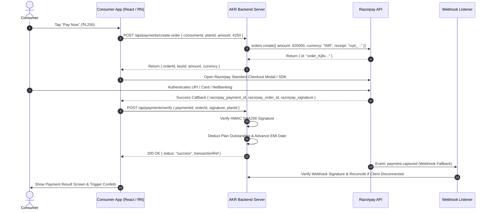

# AKR Credit Capital - Razorpay Payment Gateway Integration Guide

This guide describes how to replace the prototype's mock payment simulator (`src/services/paymentGateway.ts`) with production Razorpay Checkout on Web and React Native.

---

## 1. Architecture Overview



---

## 2. Where the Mock Gateway Sits

Open `src/services/paymentGateway.ts`. Notice the signature:

```typescript
export interface PaymentGatewayRequest {
  consumerId: string;
  planId?: string | null;
  amount: number;
  method: 'UPI' | 'CARD' | 'NETBANKING';
}

export interface PaymentGatewayResponse {
  success: boolean;
  status: 'success' | 'failed' | 'pending';
  transactionRef: string;
  orderId?: string;
  errorMessage?: string;
}

export const initiatePayment = async (
  request: PaymentGatewayRequest
): Promise<PaymentGatewayResponse> => {
  // TODO: Replace with Razorpay Checkout (order creation on backend, signature verification on webhook)
  ...
}
```

---

## 3. Step-by-Step Production Replacement

### Step 1: Backend Order Creation Endpoint (`POST /api/payments/create-order`)
In your backend service (Node.js/Express example):

```typescript
import Razorpay from 'razorpay';

const razorpay = new Razorpay({
  key_id: process.env.RAZORPAY_KEY_ID!,
  key_secret: process.env.RAZORPAY_KEY_SECRET!,
});

app.post('/api/payments/create-order', async (req, res) => {
  const { amount, consumerId, planId } = req.body;

  // Razorpay amounts are represented in Paise (₹1 = 100 paise)
  const options = {
    amount: Math.round(amount * 100),
    currency: 'INR',
    receipt: `rcpt_${consumerId.slice(0, 8)}_${Date.now()}`,
    notes: {
      consumerId,
      planId: planId || 'PAY_ALL',
    },
  };

  try {
    const order = await razorpay.orders.create(options);
    res.json({
      orderId: order.id,
      amount: order.amount,
      currency: order.currency,
      keyId: process.env.RAZORPAY_KEY_ID,
    });
  } catch (error) {
    res.status(500).json({ error: 'Failed to create Razorpay order' });
  }
});
```

---

### Step 2: Client-Side Checkout (`src/services/paymentGateway.ts`)

#### For Web (Desktop & Mobile Browser):
```typescript
export const initiatePayment = async (
  request: PaymentGatewayRequest
): Promise<PaymentGatewayResponse> => {
  // 1. Fetch order details from backend
  const orderRes = await fetch('/api/payments/create-order', {
    method: 'POST',
    headers: { 'Content-Type': 'application/json' },
    body: JSON.stringify(request),
  });
  const { orderId, keyId, amount, currency } = await orderRes.json();

  return new Promise((resolve) => {
    const options = {
      key: keyId,
      amount,
      currency,
      name: 'AKR Credit Capital',
      description: 'EMI & Dues Settlement',
      order_id: orderId,
      prefill: {
        contact: request.consumerMobile,
        email: request.consumerEmail,
      },
      theme: {
        color: '#D4AF37', // AKR Gold
      },
      handler: async function (response: any) {
        // 2. Verify payment on backend
        const verifyRes = await fetch('/api/payments/verify', {
          method: 'POST',
          headers: { 'Content-Type': 'application/json' },
          body: JSON.stringify({
            razorpay_payment_id: response.razorpay_payment_id,
            razorpay_order_id: response.razorpay_order_id,
            razorpay_signature: response.razorpay_signature,
            planId: request.planId,
            amount: request.amount,
          }),
        });
        const result = await verifyRes.json();
        resolve(result);
      },
      modal: {
        ondismiss: function () {
          resolve({
            success: false,
            status: 'failed',
            transactionRef: '',
            errorMessage: 'Payment cancelled by user',
          });
        },
      },
    };

    const rzp = new (window as any).Razorpay(options);
    rzp.open();
  });
};
```

#### For React Native:
Use `react-native-razorpay`:
```bash
npm install react-native-razorpay
```
```typescript
import RazorpayCheckout from 'react-native-razorpay';

export const initiatePaymentRN = async (request: PaymentGatewayRequest) => {
  const { orderId, keyId, amount } = await createOrderOnBackend(request);

  const options = {
    description: 'AKR Credit Dues Settlement',
    currency: 'INR',
    key: keyId,
    amount: amount,
    name: 'AKR Credit Capital',
    order_id: orderId,
    theme: { color: '#D4AF37' },
  };

  try {
    const data = await RazorpayCheckout.open(options);
    // Success: { razorpay_payment_id, razorpay_order_id, razorpay_signature }
    return await verifyPaymentOnBackend(data);
  } catch (error: any) {
    return { success: false, status: 'failed', errorMessage: error.description };
  }
};
```

---

### Step 3: Backend Signature Verification (`POST /api/payments/verify`)

```typescript
import crypto from 'crypto';

app.post('/api/payments/verify', async (req, res) => {
  const { razorpay_order_id, razorpay_payment_id, razorpay_signature, planId, amount } = req.body;

  const hmac = crypto.createHmac('sha256', process.env.RAZORPAY_KEY_SECRET!);
  hmac.update(`${razorpay_order_id}|${razorpay_payment_id}`);
  const generatedSignature = hmac.digest('hex');

  if (generatedSignature !== razorpay_signature) {
    return res.status(400).json({ success: false, errorMessage: 'Invalid signature verification' });
  }

  // Idempotent balance deduction in DB
  const paymentRecord = await executePaymentUpdate({
    transactionRef: razorpay_payment_id,
    orderId: razorpay_order_id,
    planId,
    amount,
    status: 'success',
  });

  res.json({
    success: true,
    status: 'success',
    transactionRef: razorpay_payment_id,
  });
});
```

---

### Step 4: Webhook Listener for Network Failures
Even if the consumer loses mobile data right after completing UPI payment, Razorpay sends a server-to-server webhook:
1. Setup Webhook URL: `https://api.akrcredit.com/api/webhooks/razorpay`
2. Subscribe to event: `payment.captured`
3. Verify signature using `crypto.createHmac('sha256', process.env.RAZORPAY_WEBHOOK_SECRET)`
4. If payment is marked success in Razorpay but pending in database, update the plan balance and send a push notification to the consumer.
